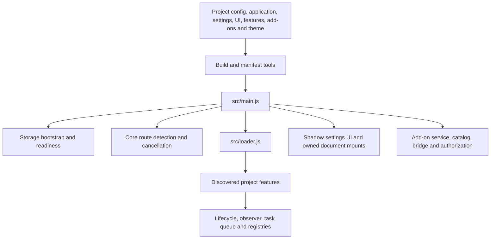

# Aperture architecture

Aperture builds one configured site-specific userscript and its selected add-ons. Project modules describe site behavior; the shared framework supplies bootstrap, route transitions, feature lifecycle, observation, queues, persistence, UI and diagnostics.

`config.json` at the repository root selects the default project. Every project command accepts `--config projects/<project>/config.json`. All paths inside config resolve from the repository root.

| Location | Responsibility |
| --- | --- |
| `projects/<project>/config.json` | Identity, site matches, routes, build paths and selected theme |
| `projects/<project>/application.js` | Storage readiness and optional UI/add-on composition |
| `projects/<project>/settings.js` | Project schema, defaults, migrations and effects |
| `projects/<project>/ui.js` | Settings tabs, sections, rich components and layer base |
| `projects/<project>/features/` | Site-specific feature implementations |
| `src/main.js`, `src/loader.js` | Bootstrap and applicability/reconciliation |
| `src/core/` | Lifecycle, route abort, observer, task queue, resource/listener/style ownership |
| `src/config/`, `src/services/` | State, schema, safe persistence, transfer, readiness and add-on services |
| `src/ui/` | Dock, settings, dialogs, toasts, renderers and add-on mounts |
| `addons/<addon>/src/`, `addons/shared/` | Add-on implementation and shared client/runtime machinery |
| `themes/<theme>/index.css` | Build-selected color tokens |
| `scripts/`, `build/` | Validation, manifests, catalogs, audits and builders |

A feature owns the resources it creates and releases them during disable. Route changes abort stale work and reconcile applicable features through the same loader. Async handlers check cancellation after awaiting. Use the central observer and task queue rather than adding another lifecycle.

Storage is shared infrastructure: schema validation, recovery, readiness and a serialized write gate decide whether a change can commit. Features and settings controls call `updateConfig`; add-ons request bounded services through the bridge. Reads succeeding does not establish writable storage.

Core settings use Shadow DOM. Some add-on mounts, dialogs and fallback toasts live in the document and receive scoped styles. Core always supplies General and Add-ons tabs, config-button visibility, import/export, Feature Health and service settings. Project tabs add behavior through metadata and owned components.

Generated manifests, catalogs and distributions are outputs. Edit project/source inputs and use the existing builders. For specific APIs see [core modules](../core/index.md), [features](features.md), [settings/UI](settings-ui.md) and [add-ons](addons.md).

Framework and project releases have separate versions. Root `package.json` is the framework version authority; `aperture:framework` exposes immutable build-time name/version metadata and the core Settings footer displays it. Project `build.versionFile` supplies the userscript `@version`, and add-ons keep independent versions. Changing Aperture's version does not bump project/add-on versions or alter storage schema versions. Rebuild a project to embed an updated framework; existing installations retain the version they were built with.

Framework patch releases fix bugs, minor releases add compatible APIs, and major releases identify breaking contracts that need migration guidance. Projects need adaptations when the APIs they use change incompatibly, not for every framework update. Ship a new project userscript release when distributing a rebuilt script to users; userscript managers track the project's `@version`.
